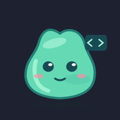

<div align="center">

# claude-pet avatars

**Looks for [claude-pet](https://github.com/r45635/claude-pet), the tiny creature that shows what Claude Code is doing.**

        

Picking one takes two clicks. Drawing one takes an afternoon.

</div>

## Try one

No claude-pet yet? It runs on Macs with Apple Silicon:
`brew install r45635/tap/claude-pet && claude-pet setup`
([other ways](https://github.com/r45635/claude-pet#readme)).

- **From the creature:** right-click → **Avatar** → **Library**, then pick one. When a newer
  version comes out, **Update <name>…** appears in the same menu. **Remove current avatar…**
  takes you back to the classic look.
- **From a terminal** (this is also the way for an agent, since it can't click a menu):

  ```bash
  claude-pet avatars list             # what the library has, and what you have installed
  claude-pet avatars install slime    # install it and show it
  claude-pet avatars update           # update every avatar you installed from here
  claude-pet avatars remove slime     # uninstall it
  ```

  <sub>If you installed claude-pet without Homebrew, the command is `~/.claude-pet/app/claude-pet`. From
  a clone, it's `npm run avatars -- list`. The terminal commands need claude-pet 0.3.1 or later, the menu 0.3.0.</sub>
- **By hand:** download a `.claudepet` file from the [latest release](../../releases/latest)
  and drop it on the creature.

## In the library

| Avatar | `id` | Kind | Notes |
|---|---|---|---|
| Ghost | `ghost` | pictures | floats, with its own flicker |
| Alien | `alien` | pictures | |
| Mint | `mint` | SVG | the commented template to start from |
| Cowboy | `cowboy` | SVG | a hat that follows the mood |
| Slime | `slime` | SVG | a face for every state, wiggles on tool calls |
| Baptawan | `baptawan` | pictures | a picture for each of the nine states (AI-assisted artwork) |
| ChloePrincess | `chloe-princess` | pictures | a candy princess, nine states (AI-assisted artwork) |
| Halloween, Noël, Nouvel An, Pâques, Saint-Valentin | `halloween`, `noel`, `nouvel-an`, `paques`, `saint-valentin` | SVG | seasonal |

## Is it safe?

An avatar is a file made by someone you don't know, so here is what it can and can't do.

- **It changes how the creature looks, never what it does.** An avatar can't run code. SVG
  goes through an allow-list that removes scripts, event handlers, links and embedded HTML.
  An avatar's CSS only reaches the avatar itself. Every file's real type is checked from its
  contents, not its name, and sizes are capped.
- **It can't phone home.** The creature's window blocks every request that leaves the app, so
  an avatar can't load anything from the internet or track you.
- **You get exactly what was published.** The library's catalog is signed with claude-pet's
  release key. The app refuses a catalog that is unsigned or altered, and any avatar whose
  SHA-256 checksum doesn't match the catalog.
- **A person looks at every avatar** before it is merged, and CI checks it against the app's
  own rules. Nothing reaches the app until a release is published.
- **Browsing the library sends nothing about you.** The app downloads the catalog from GitHub,
  and the request carries nothing but its URL. Turn off *Check for updates* (`ui.updates.check`)
  and the app stops asking. The terminal commands still work, because you ran them yourself.
  See [claude-pet's privacy notes](https://github.com/r45635/claude-pet/blob/main/docs/PRIVACY.md).
- **Everyone keeps their rights.** Every avatar names its author and its license (all MIT
  today). AI-assisted artwork says so. See [what we accept](CONTRIBUTING.md#what-we-accept).

The full rules are in
[docs/AVATARS.md](https://github.com/r45635/claude-pet/blob/main/docs/AVATARS.md#limits-and-safety).

## 🎨 Make one

Every Claude Code user who installs claude-pet can then pick your avatar from the creature's
menu. **A robot, a cat, a dragon, pixel art, your own character?** Here is what it takes:

- **Draw it however you like:** a few PNG/GIF/WebP pictures (any tool, or an image AI), an
  SVG, or a sprite sheet that the tooling cuts up for you.
- **Start small:** one picture (`IDLE`) is already a valid avatar. Each extra state (thinking,
  coding, waiting for you, in trouble…) is a bonus.
- **The pet does the acting:** breathing, shaking in storms and subagents walking around
  all come for free.
- **No git needed:** you can open the pull request from your browser.

👉 **[How to make one: the contributing guide](CONTRIBUTING.md)** ·
**[Ideas waiting for a designer](https://github.com/r45635/claude-pet-avatars/issues?q=is%3Aopen+label%3A%22good+first+avatar%22)** ·
**[Show yours, ask for help](https://github.com/r45635/claude-pet-avatars/discussions)**

## Something wrong?

- **An avatar looks wrong, won't install or won't update:**
  [open an issue](../../issues/new?template=avatar-problem.yml).
- **An avatar uses your work or shows you without your consent, or shouldn't be here at all:**
  open the same issue and choose *rights or content*. We take the avatar out of the library in
  the next release. Copies already installed stay on people's Macs until they remove them,
  because the app never deletes files remotely.
- **A security problem**, such as an avatar that gets out of its box: report it privately to the main
  repository (**Security → Report a vulnerability**,
  [link](https://github.com/r45635/claude-pet/security/advisories/new)), not in a public issue.

## How the pipeline works

On every push, CI checks each avatar with the main repository's own validator, from a checkout
of claude-pet `main`, so the rules can't drift apart. CI also packs each avatar
**reproducibly**: fixed file times and sorted entries, so the same content always gives the
same bytes and the published SHA-256 means something. CI packs everything twice and compares
the results.

On a tag `v*`, CI also signs `index.json` with the claude-pet release key and publishes these
release assets:

- `<id>.claudepet`: one per avatar
- `index.json`: `{format, generated, avatars:[{id, name, names, version, kind, license,
  author, file, sha256, bytes}]}`
- `index.json.sig`: ed25519 over `index.json`, in base64

The stable catalog URL is
`https://github.com/r45635/claude-pet-avatars/releases/latest/download/index.json`.

## License

MIT, © 2026 Vincent Cruvellier, see [LICENSE](LICENSE). The license covers this repository
**including the avatar artwork**. An avatar may declare a different license (an SPDX
identifier) in its manifest, and that license then applies to that avatar's files.

This library is the only home of the ready-made avatars: the main repository doesn't keep
copies.
